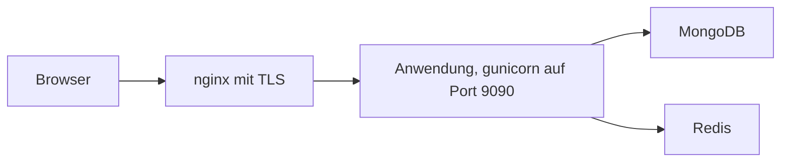

# Tourenanmeldung

Die Tourenanmeldung ist eine freie Web-Anwendung für Vereine, die Touren, Kurse und Termine anbieten. Mitglieder melden sich online an, Tourenbegleiter verwalten ihre Teilnehmer, Admins pflegen Mitglieder, Hütten und Einstellungen.

Der Quellcode steht unter der MIT-Lizenz auf [GitHub](https://github.com/bastian-kuhn/eventmanager).

## Was die Anwendung kann

- **Touren anbieten:** Name, Beschreibung, Termin, Buchungszeitraum, Plätze, Schwierigkeit, Kondition, Länge und Höhenmeter.
- **Tickets:** Jede Tour hat eine oder mehrere Ticketarten mit Preis und Höchstzahl pro Konto. Zusatztickets (zum Beispiel Leihausrüstung) belegen keinen Platz.
- **Zusatzfragen:** Pro Tour lassen sich Fragen stellen, die bei der Anmeldung beantwortet werden müssen.
- **Warteliste:** Passt eine Anmeldung nicht mehr in die freien Plätze, kommt sie komplett auf die Warteliste.
- **Teilnehmerliste:** Tourenbegleiter bestätigen Anmeldungen, schieben sie auf die Warteliste, notieren Kommentare und exportieren die Liste als CSV.
- **Abrechnung und Finanzen:** Zahlstatus pro Ticket, Buchungsnummer als Verwendungszweck, Ausgaben der Tour.
- **Hütten:** Vereinshütten mit Zimmern, Belegungskalender, Selbstbuchung durch Mitglieder und Freigabe durch die Hütten-Verwaltung.
- **Mitglieder:** Registrierung mit Bestätigung der E-Mail-Adresse, Vereinsrollen, Einwilligungen für Fotos und Kontaktdaten.

## Aufbau

Die Anwendung ist in Python mit Flask geschrieben. Die Daten liegen in MongoDB. Redis hält die Sperren für gleichzeitige Buchungen und die Zähler der Anfragelimits.

Das Diagramm in Worten: Der Browser spricht mit nginx, nginx reicht die Anfragen an die Anwendung weiter, die Anwendung liest und schreibt MongoDB und Redis.

## Wo anfangen

- Auf dem eigenen Rechner ausprobieren: [Lokal mit Docker](installation/docker.md)
- Für den Verein betreiben: [Produktion mit Docker Compose](installation/production.md) und [Betrieb bei Hetzner](operations/hetzner.md)
- Nach der Installation: [Erste Schritte](installation/first_steps.md)
- Wer darf was: [Rollen und Rechte](basics/roles.md)
